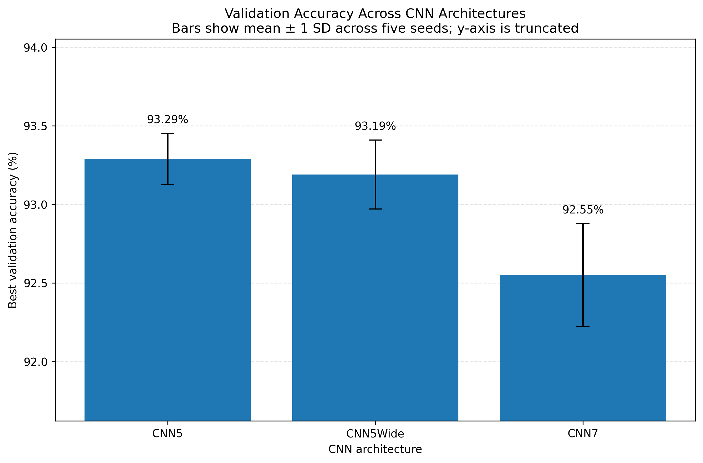
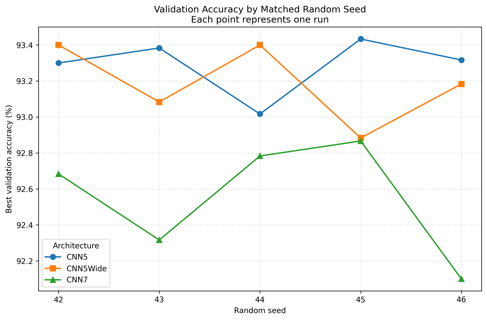
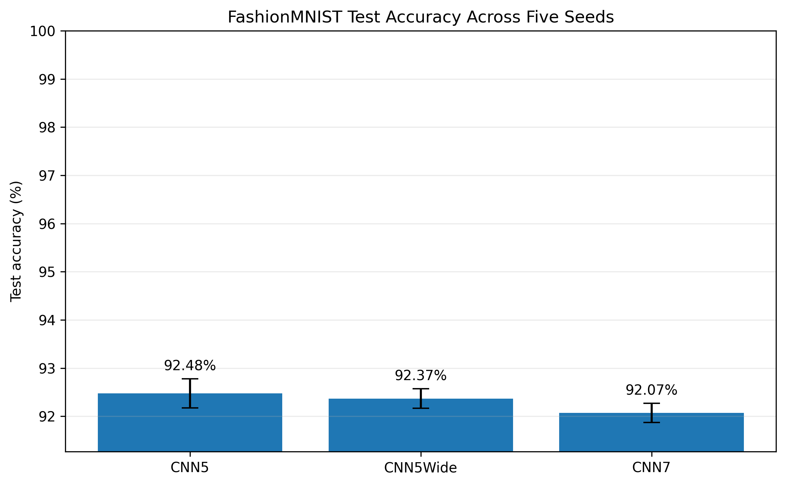
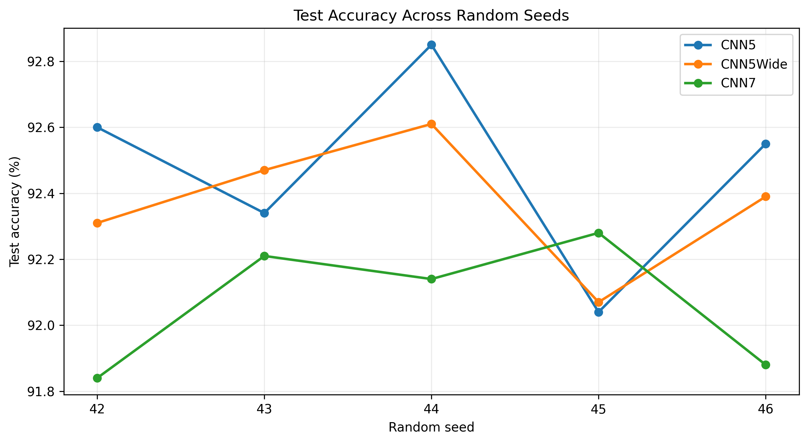
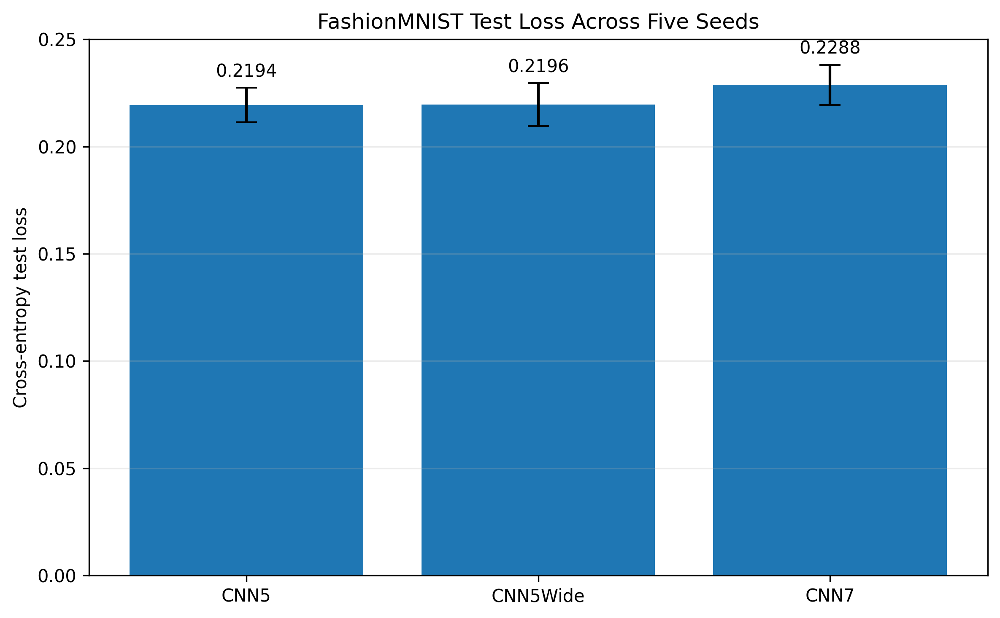

# FashionMNIST CNN Depth and Width Study

A reproducible, multi-seed experiment investigating how convolutional neural network depth and width affect image-classification performance on FashionMNIST.

This project compares three CNN architectures under a controlled training configuration. It includes repeated runs, validation-based checkpoint selection, official test-set evaluation, statistical analysis, and visual comparisons of model performance.

## Research Question

**How do changes in CNN depth and width affect classification performance, model complexity, and run-to-run variability under a fixed training configuration?**

The study compares three architectures:

- **CNN5:** baseline architecture with five convolutional layers.
- **CNN5Wide:** wider variant of the five-layer architecture.
- **CNN7:** deeper architecture with seven convolutional layers.

The goal is to understand the behavior of these specific architectures under the experimental conditions used, not to establish that one network depth is universally optimal.

## Architectures

| Model | Description | Trainable parameters |
|---|---|---:|
| CNN5 | Five convolutional layers | 2,142,474 |
| CNN5Wide | Wider five-layer CNN | 2,386,954 |
| CNN7 | Seven convolutional layers | 2,326,986 |

The models use grayscale images and produce predictions for ten classes.

## Dataset

The experiments use [FashionMNIST](https://github.com/zalandoresearch/fashion-mnist), a dataset of grayscale clothing images with ten categories:

1. T-shirt/top
2. Trouser
3. Pullover
4. Dress
5. Coat
6. Sandal
7. Shirt
8. Sneaker
9. Bag
10. Ankle boot

The training pipeline applies tensor conversion and normalization using mean `0.2860` and standard deviation `0.3530`.

A fixed 10% validation split is created from the training data using split seed `2026`. The official test set contains 10,000 images and is kept separate from checkpoint selection.

## Experimental Protocol

### Training configuration

| Setting | Value |
|---|---|
| Framework | PyTorch |
| Optimizer | Adam |
| Learning rate | 0.001 |
| Loss function | Cross-Entropy Loss |
| Batch size | 128 |
| Maximum epochs | 50 |
| Early-stopping patience | 5 epochs |
| Checkpoint selection | Lowest validation loss |
| Random seeds | 42, 43, 44, 45, 46 |
| Validation fraction | 10% of training data |
| Validation split seed | 2026 |

Training stops early when validation loss fails to improve for the configured patience period. The model weights associated with the lowest validation loss are restored for evaluation.

Each architecture is evaluated across five random seeds, giving 15 runs per complete three-model experiment.

### Two separate experiment stages

The project contains two distinct stages that should not be conflated:

1. **Original Colab validation experiments:** 15 GPU runs used for the initial validation comparison and exploratory paired statistical analysis. These results are recorded in `results/raw_results.json`.
2. **CPU retraining and official test evaluation:** 15 additional CPU runs, followed by evaluation of their saved best-validation-loss checkpoints on the official test set. These results are recorded in `results_cpu_cnn5/`, `results_cpu_additional/`, and `results_test_comparison/`.

The CPU test results below therefore refer to the CPU-trained checkpoints, not the original Colab checkpoints.

## Results

### 1. Original Colab validation experiments

| Model | Mean validation accuracy | Sample SD | Range |
|---|---:|---:|---:|
| **CNN5** | **93.29%** | 0.162 pp | 93.02–93.43% |
| CNN5Wide | 93.19% | 0.220 pp | 92.88–93.40% |
| CNN7 | 92.55% | 0.328 pp | 92.10–92.87% |

CNN5 achieved the highest mean validation accuracy in the original experiment. CNN5Wide performed similarly, while CNN7 had lower mean validation accuracy and greater observed variability.





### 2. Official test-set evaluation of CPU-trained checkpoints

Each saved checkpoint was evaluated on all 10,000 images in the official FashionMNIST test set.

| Model | Mean test accuracy | Sample SD | Mean test loss |
|---|---:|---:|---:|
| **CNN5** | **92.48%** | 0.30 pp | **0.2194** |
| CNN5Wide | 92.37% | 0.20 pp | 0.2196 |
| CNN7 | 92.07% | 0.20 pp | 0.2288 |

The sample standard deviation is calculated across the five independently trained seeds and is expressed in percentage points.







### Main observations

- **CNN5 achieved the highest mean test accuracy** and the lowest mean test loss among the three tested configurations.
- CNN5Wide used approximately 11.4% more parameters than CNN5 but did not improve mean test accuracy.
- CNN7 also used more parameters than CNN5 and achieved the lowest mean test accuracy.
- The observed test-accuracy differences were modest: CNN5 exceeded CNN5Wide by 0.11 percentage points and CNN7 by 0.41 percentage points.

These results suggest that increasing depth or width did not improve performance under this particular training setup. They do not establish a universal relationship between network depth and generalization.

## Exploratory Statistical Analysis

Paired comparisons were conducted on the original Colab validation results using the five matched random seeds.

### CNN5 versus CNN7

The mean validation-accuracy difference was approximately **0.74 percentage points in favor of CNN5**.

The paired t-test produced:

- *t* = 4.1501
- *p* = 0.0143
- Degrees of freedom = 4

The unadjusted p-value is below 0.05. However, multiple architecture comparisons were performed, and the Holm-adjusted p-value for this comparison was approximately 0.0428. The result remains below 0.05 under that adjustment, but the evidence should be interpreted cautiously because only five matched observations were available.

An exact Wilcoxon signed-rank test produced *p* = 0.0625 for this comparison, illustrating the uncertainty associated with such a small sample.

### CNN5 versus CNN5Wide

The mean validation-accuracy difference was approximately **0.10 percentage points in favor of CNN5**.

The paired t-test produced:

- *t* = 0.6218
- *p* = 0.5677
- Degrees of freedom = 4

This comparison did not provide sufficient evidence of a difference in validation accuracy between CNN5 and CNN5Wide.

These tests are exploratory and concern the original Colab validation results. They should not be interpreted as statistical tests of the CPU test-set results.

## Interpretation

Across the experiments reported here, CNN5 was the strongest overall configuration by mean accuracy. CNN5Wide did not show a meaningful observed improvement despite having more parameters, and CNN7 did not outperform the baseline.

Several explanations are possible, including optimization behavior, the fixed training configuration, architectural differences beyond depth alone, and variation across random initializations. The present experiments do not isolate these mechanisms.

A stronger follow-up study could increase the number of seeds, compare more architectures, evaluate training cost, and use additional datasets. Any further model selection should be conducted using training and validation data rather than repeatedly optimizing against the official test set.

## Reproducibility

### Requirements

The project uses Python and the following main packages:

- PyTorch
- Torchvision
- NumPy
- Pandas
- Matplotlib
- SciPy

Install the dependencies with:

```bash
pip install -r requirements.txt
```

### Run the experiments

From the project root, the original CPU CNN5 experiments can be run with:

```bash
python src/run_experiment.py
```

The additional CNN7 and CNN5Wide CPU experiments can be run with:

```bash
python src/run_additional_cpu_models.py
```

These commands train models. Do not run them if you only want to inspect the existing results.

### Evaluate the saved checkpoints

To evaluate the original CNN5 CPU checkpoints:

```bash
python src/evaluate_test.py
```

To evaluate all three CPU-trained architectures and generate the combined test summaries:

```bash
python src/evaluate_all_test.py
```

To regenerate the three test-comparison figures:

```bash
python src/create_test_comparison_plots.py
```

Run the scripts from the project root. The dataset must be available locally or downloadable through the existing Torchvision data-loading pipeline. The exact commands assume a Python environment with the listed dependencies installed.

## Output Files

### Original validation results

- `results/raw_results.json` — original Colab run-level results and training histories.
- `results/summary_statistics.csv` — validation summary statistics.
- `results/run_level_results.csv` — run-level validation results.
- `results/validation_accuracy_comparison.png` — validation accuracy comparison.
- `results/validation_accuracy_by_seed.png` — validation accuracy across seeds.

### CPU training and test evaluation

- `results_cpu_cnn5/` — CNN5 CPU run results and checkpoints.
- `results_cpu_additional/` — CNN7 and CNN5Wide CPU run results and checkpoints.
- `results_test_comparison/all_test_results.csv` — individual test results for all 15 runs.
- `results_test_comparison/all_test_results.json` — detailed test results and architecture summaries.
- `results_test_comparison/architecture_summary.csv` — aggregate test metrics.
- `images/test_accuracy_comparison.png` — mean test accuracy with error bars.
- `images/test_accuracy_by_seed.png` — test accuracy for each random seed.
- `images/test_loss_comparison.png` — mean test loss with error bars.

Model checkpoints are kept locally and excluded from Git tracking to avoid unnecessarily large repository uploads. The result tables and figures are provided for inspection.

## Limitations

- Only three CNN configurations were studied.
- Each architecture was evaluated across five random seeds.
- The original statistical analysis has low power because it uses five matched observations.
- The training configuration was fixed rather than separately optimized for each architecture.
- The study uses a single dataset.
- CPU retraining and original Colab experiments used separate trained checkpoints, so their validation results should not be treated as measurements from the same models.
- No claim is made that the observed ranking generalizes to all CNN architectures or image-classification tasks.

## Future Work

Potential extensions include:

- Increasing the number of random seeds.
- Evaluating additional depth and width configurations.
- Comparing parameter efficiency and training time.
- Investigating regularization and normalization strategies.
- Analyzing class-wise errors and confusion matrices.
- Evaluating the architectures on additional datasets.

## Conclusion

Under the training and evaluation configuration used in this project, CNN5 achieved the highest mean test accuracy among the three evaluated architectures, at **92.48% across five CPU-trained runs**. CNN5Wide achieved 92.37%, while CNN7 achieved 92.07%.

The original Colab validation experiments showed a similar ranking, with CNN5 achieving 93.29% mean validation accuracy. These validation and test figures come from separate experiment stages and are reported independently.

Overall, the results demonstrate the value of repeated experiments, validation-based checkpoint selection, independent test evaluation, and careful interpretation of model comparisons. Increasing model capacity did not automatically improve performance in the configurations tested.

---

**Technologies:** Python · PyTorch · Torchvision · NumPy · Pandas · Matplotlib · SciPy
